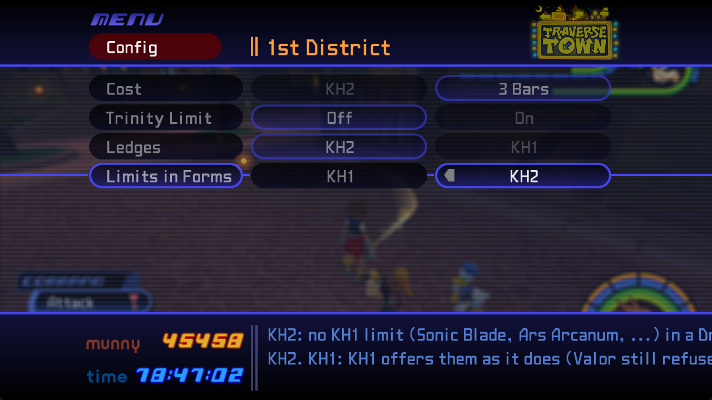

# Drive Forms, Drive Recovery, Config menu and title screen bugs

[Back to the tester requests](../../docs/tester-requests.md)

## Messages

- [1. PM2CRAZY (owner, chat 2026-10-31, copied word for word): 1. you can guard in final form and master form and it looks ](#^m1)
- [2. PM2CRAZY (owner, chat 2026-11-02, copied word for word): Make an exception. Do everything I asked, and also, when goi](#^m2)
- [3. Assistant: Eight versions, t1077 to t1084: one per system. None of them](#^m3)
- [4. PM2CRAZY (owner, chat 2026-11-02, copied word for word): 1. Have the parry effects, but let the attack play out.](#^m4)
- [5. Assistant: Thanks. No version this round: two of these need one more th](#^m5)
- [6. PM2CRAZY (owner, chat 2026-11-02, copied word for word): 1. a](#^m6)
- [7. Assistant: t1085, growth abilities. Quick Run, Aerial Dodge and Dodge R](#^m7)

---

> [!note] Tester PM2CRAZY (owner, chat 2026-10-31, copied word for word)
> 1. you can guard in final form and master form and it looks crazy
>
> final form shouldn't be clinking with anything
>
> loading into a save should give you the appropriate level of all growth abilities
>
> both drive recovery looks like "e" when using the item submenu of command menu in battle
>
> both drive recovery cant be used in battle
>
> limit form shortcuts dont change to show the limits
> 2.
> 3. also in most menus, the text at the bottom extends past the screen, and also some minor inconsistencies with where "KH2" is
> 4. like KH2 is the first option for cost and ledges, but the second option for limits
>
> 

^m1

> [!note] Tester PM2CRAZY (owner, chat 2026-11-02, copied word for word)
> Make an exception. Do everything I asked, and also, when going to the title screen from a save menu, the game gets stuck on a loading screen indefinitely

^m2

> [!tip] Assistant
> Eight versions, t1077 to t1084: one per system. None of them has been seen in game, and this session had no decomp or exe, so every address is one the repo already had, and anything I couldn't confirm is marked Assumption in AGENTS.md and the docs.
>
> **Config menu**
> - **t1077, KH2 always on the right.** Drive > Limit's Cost is now 3 Bars | KH2 and Ledges is KH1 | KH2, like every other row. Your saved settings keep their values. I checked the code: those were the only two rows the other way round.
> - **t1078, help lines fit the screen.** A help line of ours that's wider than the screen is now drawn smaller, just enough to fit. I worked out the room from your screenshot and KH1's own width function. KH1's own help texts are left alone.
>
> **Title screen hang**
> - **t1079.** My best guess at the cause: our KH2 sound banks kept putting themselves back into KH1's sound lists on every frame, including on the way back to the title. If KH1 waits for those lists to empty before the title (I couldn't check this in the decomp), it would wait forever. Now ours stay out whenever KH1 isn't in a game and come back once you're playing. If it still hangs, the log will show where it stops (see below).
>
> **Limit Form shortcuts**
> - **t1080.** In Limit Form, L1 now shows its four limits in KH1's own shortcut menu: Sonic Rave on Triangle, Last Arcanum on Square, Strike Raid on confirm, Infinity on cancel. With 3 shortcuts set in the ini, Infinity has none. They start and grey out the same way as the Limit list. Your own shortcuts come back when you leave the form, and saving in the form saves your own. Assumption: the button order. It's KH2's table as the main branch read it from the exe; I couldn't read it on testing. No main-branch data was copied.
>
> **Guard in Master and Final**
> - **t1081, Master.** KH2's Master has no guard or roll (checked in KH2's files). With Dodge Roll on KH1, KH1's own Square started its guard (base Sora's guard animation on Master) or KH1's roll. Square on the ground now does nothing in Master, as in Valor, Wisdom and Final. The Aerial Dodge is unchanged.
> - **Final.** Final already ignores Square, and I couldn't find what starts the guard you saw by reading the code. t1081 adds a log line for it: KH1's guard playing in Master or Final is logged once, with Sora's state and whether Square was held.
>
> **Final clinking (not built: I need your answer)**
> - In KH2's own code (checked in the decomp in an earlier round), a Final hit that meets an enemy attack or a guard is never stopped. It parries the attack, and Sora plays a small clash spark with no recoil. So Final does "clink" in KH2. Ours plays KH1's clang (spark and clash sound) in its place, which is likely louder than KH2's spark. I couldn't check what KH2's spark looks or sounds like. Notes are in `docs/kh1-kh2-recoil.md` §6.11.
>
> **Drive Recovery in battle**
> - **t1082, the "e".** KH1's battle lists name and run each row from a command record, and our two items had none: an empty name ("e"), and picking one did nothing. They now get KH1 commands copied from KH1's own first item command. Assumption: KH1's item commands are numbered item + 0x1E. The mod checks that against KH1's own items when it starts, and writes nothing (with a log line) if it's wrong.
> - **t1083, using it.** The battle use passes Sora in a form the mod didn't recognise, so it refused him. It now also accepts his actor. Each use logs its target.
> - All of this is with Drive > Recovery in Battle On. With it Off they're menu-only, which is KH2's own rule.
>
> **Growth abilities after loading**
> - **t1084.** I found the levels already come straight from the save's form levels, and a load restores the whole save, so nothing is lost on load. One real bug: loading a second save in one session could show an "Ability Up" box for levels it already had. That's fixed.
> - What probably made it look wrong: a growth ability only counts if Sora has it and it's equipped. KH1's own High Jump, Glide and Dodge Roll only come from KH1 (the earlier "keep KH1 vanilla" choice). Quick Run and Aerial Dodge are given switched off. And base Sora is one level under the form, as in KH2. KH2 itself puts the growth ability in Sora's list as soon as a form level gives it.
>
> **Please test**
> 1. Config > Drive > Limit: KH2 is on the right for Cost and Ledges, and each keeps your old choice. Check that help lines fit on every list, including the long ones in QoL and Progression.
> 2. Save point, return to title, then Continue. Use a few moves to check KH2 sounds still play. Try it once in a Drive Form too.
> 3. Limit Form: hold L1, check that the four names show and each one starts its limit. Then revert, die, change rooms and go to the title: your own shortcuts should be back. Save in the form, reload and check Customize.
> 4. Master at Dodge Roll KH1: Square on the ground does nothing. Aerial Dodge still works.
> 5. Drive Recovery with Recovery in Battle On: put it in Sora's slots, check its name in battle and use it with the gauge not full.
> 6. Load one save, go to the title, load another with higher form levels: there should be no "Ability Up" box.
>
> **Logs I'd like** (turn on Loading & Cache, Combat, Forms and Menus):
> - if the title still hangs, wait about 20 s on the stuck screen, then send `kh1-kh2.log` (the "KH1 game mode" lines);
> - if you can guard in Final again, guard once, send the log and tell me which button and what you were doing;
> - if Drive Recovery still shows "e" or won't work, the lines starting "Drive Recovery".
>
> **Questions**
> 1. Final clinking: (a) keep KH2's parry but drop KH1's clash sound and use a quieter spark; (b) Final's hits meet nothing at all, no parry and no spark (not KH2's rule); (c) leave it as KH2's.
> 2. Growth abilities: (a) KH2's way: at load and at each form level-up, give Sora any growth ability his form levels reach, including KH1's own High Jump, Dodge Roll and Glide. This reverses the "keep KH1 vanilla" choice. (b) Only switch on the growth abilities he already has. (c) Something else. If (a), should they arrive equipped or switched off?
> 3. Did you expect base Sora to reach MAX (the form's own level)? In KH2's code he stays one level under the form.
> 4. Drive Recovery in battle: (a) keep KH1's party target list (only Sora works), or (b) use it on Sora straight away?
> 5. Your point 2 came through empty. Did you mean to write something there?

^m3

> [!note] Tester PM2CRAZY (owner, chat 2026-11-02, copied word for word)
> 1. Have the parry effects, but let the attack play out.
> 2. im not quite sure what this question is asking, could you rephrase? also, sora should be 1 level the respective form just like KH2.
> 3. Just have it be used on sora straight away

^m4

> [!tip] Assistant
> Thanks. No version this round: two of these need one more thing before I can build them safely.
>
> **1. Final.** Which attack should play out?
> - (a) Sora's Final swing. By the code it already keeps going through a parry: only the enemy's attack is stopped, and the enemy recoils. If you see Final's swing stop in game, tell me where (or send a log with Combat on), because then something else is stopping it.
> - (b) The enemy's attack. It isn't cancelled and the enemy doesn't recoil, so it can still hit Sora. Only the spark and sound show.
> - (c) Both.
>
> **2. Growth abilities, put more simply.** In KH2, when a form levels up, the growth ability is added to Sora's abilities by itself. For example, Valor reaching Lv2 adds High Jump to his list. Here, a form's level only raises an ability's level if Sora already has that ability: High Jump, Glide and Dodge Roll only come when KH1 gives them, and Quick Run and Aerial Dodge are given switched off. So the question is: should form levels add the growth abilities to Sora's list as KH2 does? (a) Yes, and switched on; (b) yes, but switched off; (c) no, keep it as now. And noted: base Sora one level under each form, as in KH2. That's the rule already, so nothing changes there.
>
> **3. Drive Recovery on Sora straight away.** Noted. Removing the party list means KH1's battle item use has to run with no target picked, and KH1 has no item of its own that does that. I need to read in the KH1 decomp how its battle item use takes the target, so I don't hand it an empty one (that could crash). I didn't have the decomp in this session; I'll build it as soon as I can read it.

^m5

> [!note] Tester PM2CRAZY (owner, chat 2026-11-02, copied word for word)
> 1. a
> 2. High Jump, and glide/superglide should only be given out where you get them in KH1. Once sora gets them, he can level them up. dodge roll and the other growth abilities can function how they do in KH2.
>
> 3. when selecting the item, just have soras name appear

^m6

> [!tip] Assistant
> **t1085, growth abilities.** Quick Run, Aerial Dodge and Dodge Roll now come the KH2 way. Each one is added, with a "New Ability" box, once its form (Wisdom, Master or Limit) is high enough that base Sora's level for it reaches LV1. Sora stays one level under the form, as in KH2. High Jump, Glide and Superglide still come only where KH1 gives them; after that, form levels raise them. KH1 still gives its own Dodge Roll at its level-up as well. A save that already had Quick Run or Aerial Dodge without the form level loses them until the form gets there. A new ability goes in equipped if Sora has the AP for it, otherwise off. Checked against KH2's rule from an earlier decomp round (`0x1403E8380`); not seen in game.
>
> **1. Final, (a).** By the code, Sora's Final swing already keeps going through a parry: only the enemy's attack is stopped. So I haven't changed anything. If you still see Final's swing stop or "clink" in game, please send a log with Combat on and say where it happened; then something else is stopping it, and the log will show what.
>
> **3. Only Sora's name in the target list.** I understand. KH1 refills that party list every frame, after the point where the mod can step in today. To show only Sora, I need to know either which name KH1's one-entry target list (command 0x4C in `btltbl.bin`) shows, or the first bytes of KH1's next fill step (`0x140292760`), so I can hook it safely. Both are in your extracted files and the decomp, which I didn't have here. I'll build it once I can read them.
>
> **Please test (t1085):**
> 1. On an early save, Quick Run and Aerial Dodge aren't in the KH2 list.
> 2. Raise Wisdom to Lv3: Quick Run LV1 appears with its box. Master gives Aerial Dodge the same way, and Limit gives Dodge Roll.
> 3. Load a save whose Wisdom is already Lv3 or higher: Quick Run is there right after loading.
> 4. Tell me if KH1's own level-up gives a second Dodge Roll after Limit already gave you one.
>
> **Question:** should a new growth ability always go in equipped, even when Sora doesn't have the AP (so it always works, as KH2's do), or stay as now, off when the AP doesn't fit?

^m7

